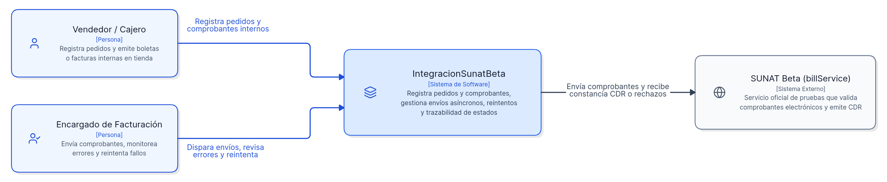
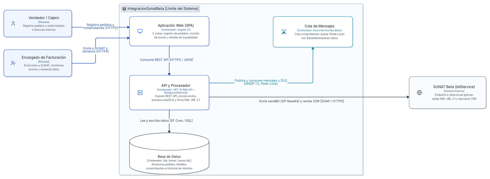
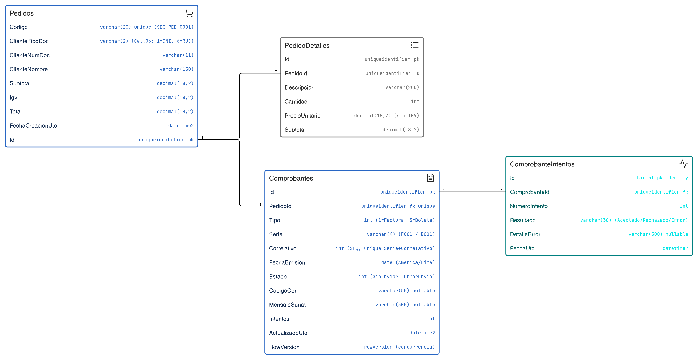
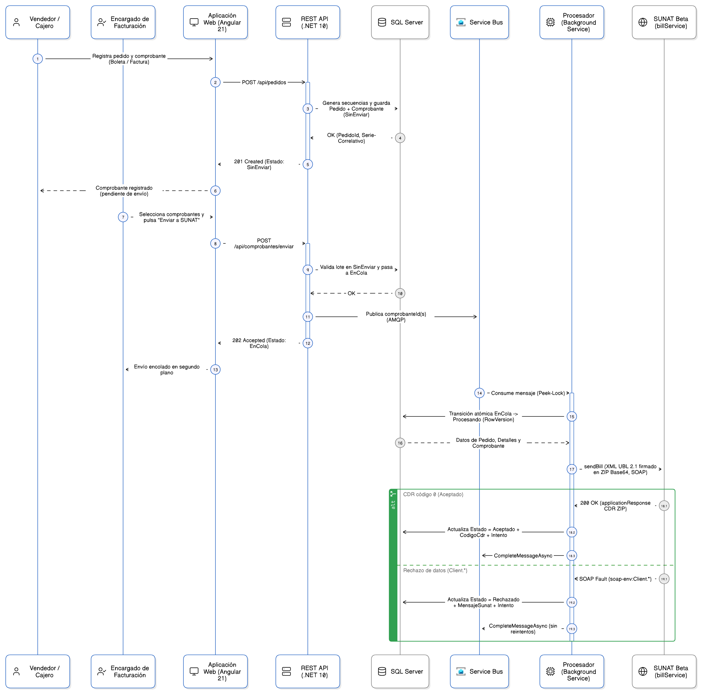
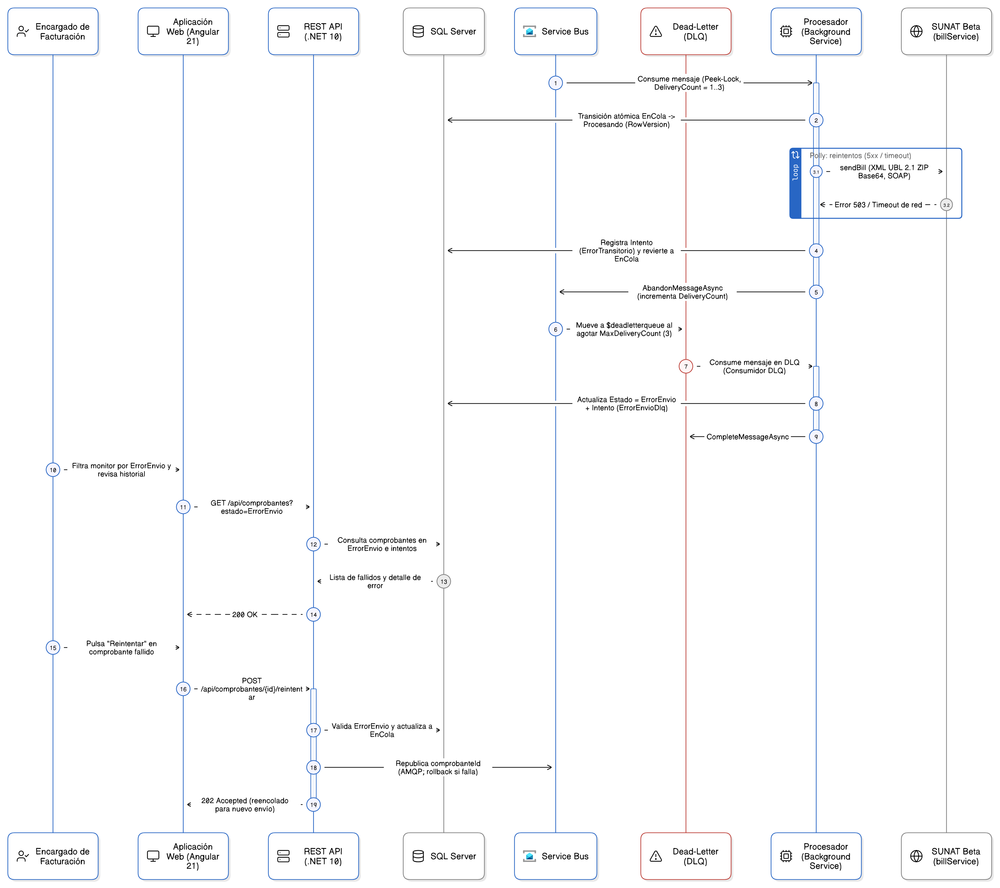

# Integración SUNAT Beta

Aplicación web en **.NET 10** y **Angular** para registrar pedidos con su comprobante interno en **SQL Server** y gestionar su envío asíncrono hacia el **ambiente Beta oficial de SUNAT** (`e-beta.sunat.gob.pe`) mediante **Azure Service Bus**.

**Stack:** .NET 10 (`ASP.NET Core Web API` + `BackgroundService` + `Polly`), EF Core 10, SQL Server / Azure SQL, Azure Service Bus, SUNAT Beta SOAP (`billService`), FluentValidation, xUnit, Angular 21, Docker y GitHub Actions.

**Estado actual:** Arquitectura, modelo de datos y diagramas definidos; implementación de backend y frontend en progreso.

---

## Qué problema resuelve

En negocios comerciales en Perú, el momento en que el **Vendedor / Cajero** registra una venta no siempre coincide con el envío a SUNAT (muchas veces se revisa primero o se envía por lotes). Además, enviar comprobantes de forma síncrona directamente desde la petición HTTP puede provocar timeouts si el servicio externo responde lento o falla, dejando estados ambiguos.

El sistema separa el proceso en dos flujos claros:

1. **Registro comercial (`SinEnviar`):** El **Vendedor / Cajero** registra el pedido junto con su boleta o factura interna en SQL Server dentro de una transacción, sin contactar todavía a SUNAT.
2. **Envío asíncrono y monitoreo:** El **Encargado de Facturación** selecciona uno o varios comprobantes y dispara el envío hacia **Azure Service Bus** (`202 Accepted`). El consumidor en segundo plano (`BackgroundService`) construye el XML **UBL 2.1**, lo firma con un certificado `.pfx` de prueba, lo comprime en `.zip` y lo envía por SOAP (`sendBill`) a `e-beta.sunat.gob.pe`:
   - Si SUNAT devuelve el CDR válido → **`Aceptado`**.
   - Si SUNAT rechaza datos (`soap-env:Client.*`) → **`Rechazado`** (sin reintentos).
   - Si ocurre un fallo transitorio de red o `5xx` persistente tras reintentos (**Polly**) → el mensaje pasa a `$deadletterqueue` para quedar marcado como **`ErrorEnvio`** con su historial de intentos y botón de reenvío manual.

---

## Arquitectura y Diagramas

### 1. C4 Nivel 1 — Contexto del Sistema

### 2. C4 Nivel 2 — Contenedores

### 3. Modelo de Datos (SQL Server)

### 4. Secuencia 1 — Registro Comercial y Envío (`Aceptado` / `Rechazado`)

### 5. Secuencia 2 — Fallo Transitorio, Polly, DLQ y Reintento Manual

